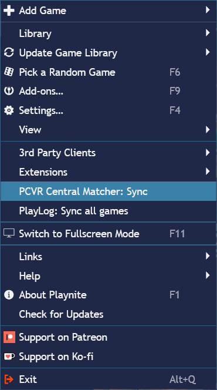
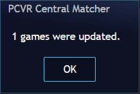
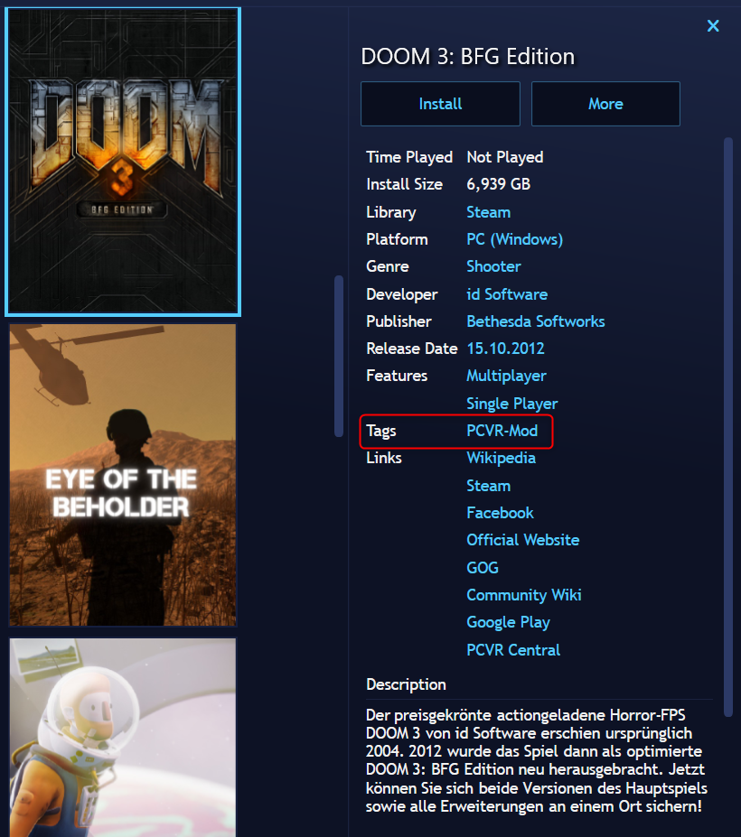
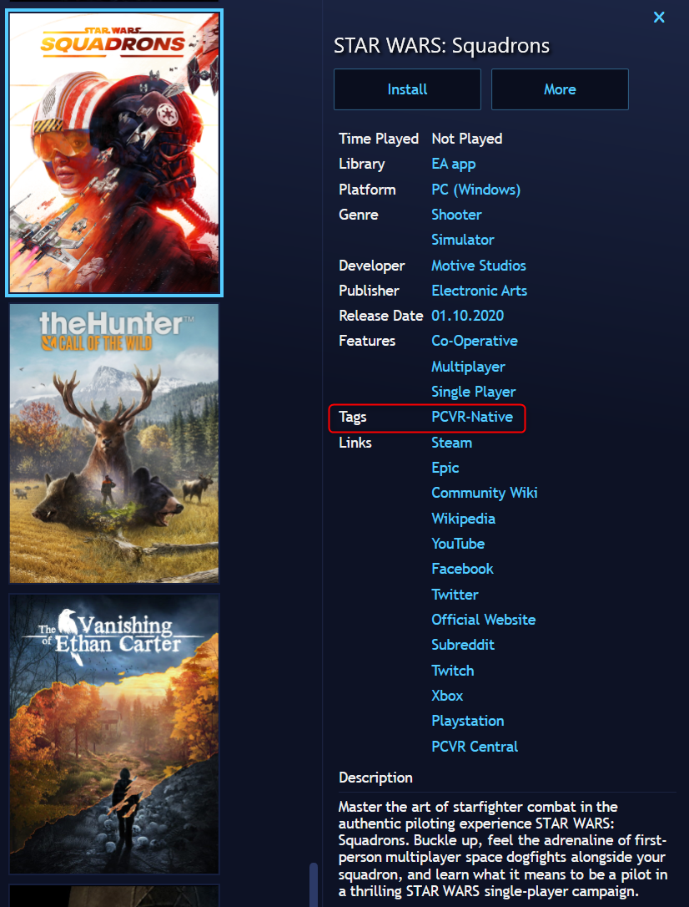
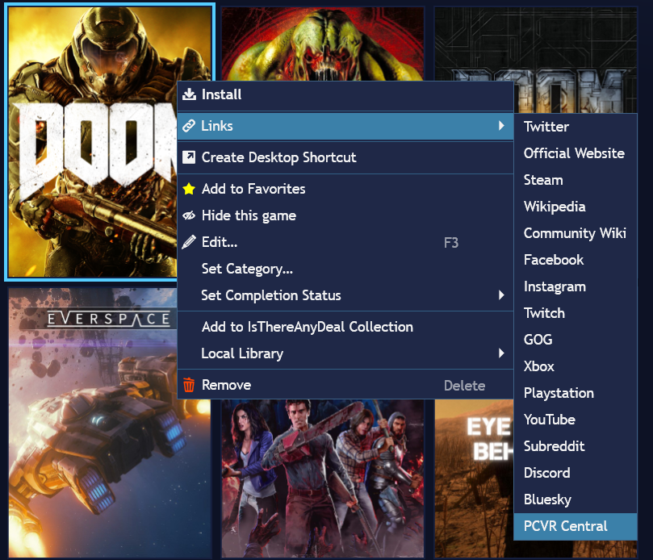

# PCVR Central Matcher

A Playnite script extension that synchronizes your library with PCVR Central.

## Features

- Matches your Playnite library against the PCVR Central catalog
- Adds a "PCVR Central" link to supported games
- Tags games requiring VR mods with `PCVR-Mod`
- Tags games with built-in VR support with `PCVR-Native`
- Automatically removes incorrect VR tags during synchronization
- Safe to run multiple times

## Screenshots

### Sync Menu



### Synchronization Result



### PCVR-Mod Tag



### PCVR-Native Tag



### PCVR Central Link



## Requirements

Create the following Playnite tags before using the extension:

- PCVR-Mod
- PCVR-Native

## Installation

1. Download the latest release from the Releases page.
2. Extract the ZIP archive.
3. Copy the included folder

   ```
   PCVRCentralMatcher
   ```

   to your Playnite extensions directory:

   ```
   %appdata%\Roaming\Playnite\Extensions
   ```

4. Restart Playnite.
5. Create the following tags in Playnite:

   - PCVR-Mod
   - PCVR-Native

6. Run:

   ```
   Main Menu → PCVR Central Matcher: Sync
   ```

The extension will automatically:

- Match your library against the PCVR Central catalog
- Add PCVR Central links
- Apply the PCVR-Mod tag to games requiring VR mods
- Apply the PCVR-Native tag to games with built-in PCVR support

## Tags

### PCVR-Mod

Games that require a VR modification.

Examples:

- Cyberpunk 2077
- Ready or Not
- Alien: Isolation

### PCVR-Native

Games with built-in PCVR support.

Examples:

- VRChat
- War Thunder
- Euro Truck Simulator 2

## Development

This project was created collaboratively by the author and Microsoft Copilot (GPT-5).

The author defined the feature set, performed all testing and validation, and made all release decisions. Microsoft Copilot assisted with code generation, troubleshooting, refactoring, and documentation.

Every release is manually reviewed and tested before publication.

## Note

This extension currently targets Playnite 10 and is implemented as a PowerShell script extension.

## Credits

PCVR Central

https://pcvrcentral.com

Playnite

https://playnite.link

## License

MIT License
