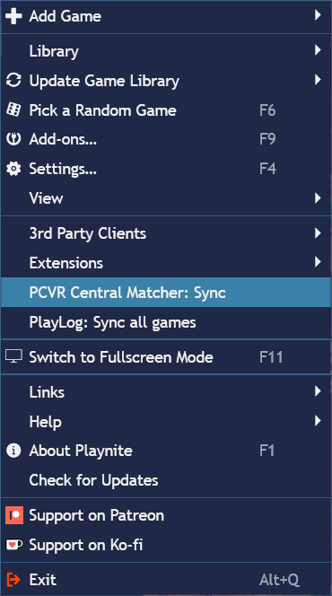
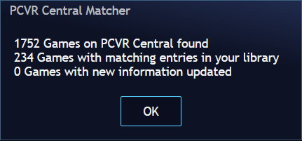
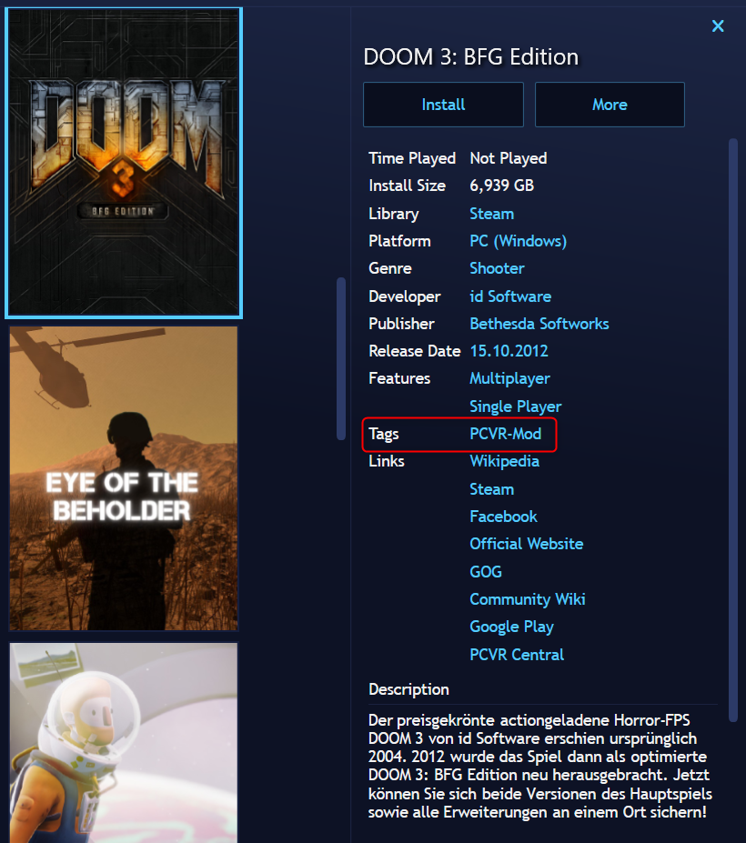
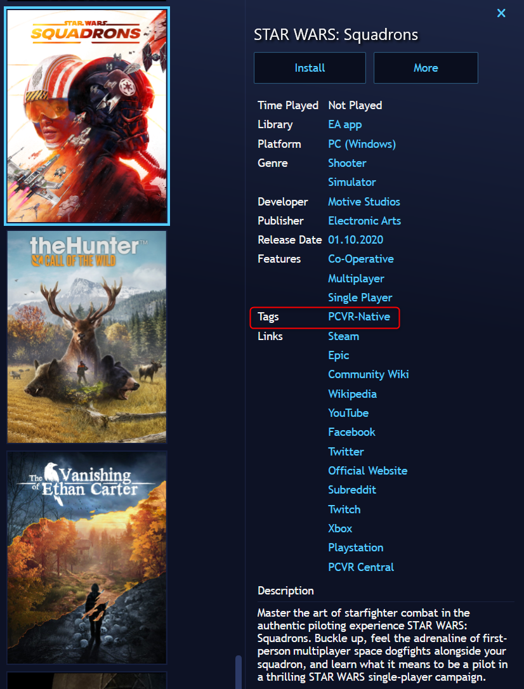
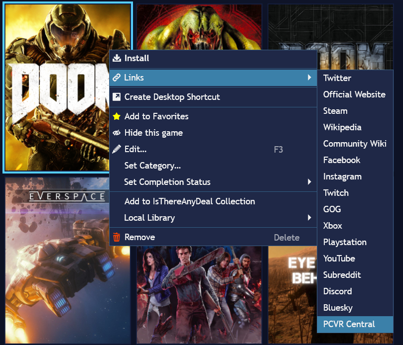

# PCVR Central Matcher

A Playnite script extension that synchronizes your library with PCVR Central and automatically assigns PCVR-related tags.

## Version

1.1.0

## Overview

This extension compares the games in your Playnite library with the PCVR Central catalog and then:

- adds a "PCVR Central" link to matching games
- applies the `PCVR-Mod` tag when a title requires VR modding
- applies the `PCVR-Native` tag when a title has native PCVR support
- adds aggregated metadata tags such as framework, motion controls, and platform where available
- ignores the platform tag `PCVR` when building the final platform list, so only relevant platform tags remain

The extension is designed to be safe to run multiple times and to be efficient on subsequent syncs.

## Features

- Matches Playnite games against the PCVR Central catalog
- Adds a "PCVR Central" link to supported games
- Applies `PCVR-Mod` and `PCVR-Native` tags
- Extracts metadata from mod pages and maps it to tags
- Normalizes platform values and ignores the generic `PCVR` platform tag
- Stores cache and update files in the Playnite extension data directory
- Performs a lightweight update-only pass after the initial sync

## How it works

The script runs in a multi-step process:

1. Downloads the current game list from PCVR Central.
2. Normalizes names to make matching robust across formatting differences.
3. Searches the mod pages for each matching game and reads relevant metadata.
4. Builds a normalized mod list and then derives a final tag list.
5. Compares the result with the previous sync snapshot.
6. Applies only the required changes to your Playnite library.

### Files created

The extension stores data in this directory:

```text
%AppData%\Roaming\Playnite\ExtensionsData\PCVRCentralMatcher_Extension
```

The following files are generated:

- `PCVRCentral_Gamelist.csv`
- `PCVRCentral_Gamelist_Update.csv`
- `PCVRCentral_Modlist.csv`
- `PCVRCentral_Modlist_Update.csv`
- `PCVRCentral_Taglist.csv`
- `PCVRCentral_Taglist_Update.csv`

## Sync behavior

### First sync

On the first run, the script creates the full data set and processes the library in a full comparison mode.

This means it:

- reads the full PCVR Central catalog
- reads the relevant mod metadata
- creates the tag list
- matches all Playnite titles against the catalog
- applies tag changes and links where necessary

### Later syncs

On later runs, the script compares the old and new data snapshots and only processes changed entries.

This makes the software:

- much faster on recurring syncs
- more stable for repeated use
- more efficient for larger libraries

### Tag logic

The extension decides between the two main tags as follows:

- `PCVR-Mod`: the game requires a VR mod
- `PCVR-Native`: the game has native PCVR support

Additional tag data can come from:

- framework
- motion controls
- platform

The platform normalization ignores the generic `PCVR` platform tag so that the final platform tags stay meaningful and match the actual hardware/platform categories.

## Requirements

The script creates missing tags automatically if they are absent, but the expected main tags are:

- `PCVR-Mod`
- `PCVR-Native`

## Installation

1. Download the latest release from the Releases page.
2. Extract the ZIP archive.
3. Copy the included folder to your Playnite extensions directory:

   ```text
   %AppData%\Roaming\Playnite\Extensions
   ```

4. Restart Playnite.
5. Start the sync from:

   ```text
   Main Menu → PCVR Central Matcher: Sync
   ```

## Screenshots

### Sync menu



### Synchronization result



### PCVR-Mod tag



### PCVR-Native tag



### PCVR Central link



## Tags used by the extension

### PCVR-Mod

Used for games that require a VR modification or support layer.

### PCVR-Native

Used for games with built-in PCVR support.

### Additional metadata tags

Examples may include values such as:

- Quest
- Pico
- PSVR2
- VorpX
- Full motion controls
- Gamepad only
- Dedicated VR mod

## Release notes

### 1.1.0

- final single-pass tag generation introduced
- update files used for efficient delta processing
- improved data handling for mod metadata and platform normalization
- AppData-based storage path moved to Playnite extension data directory
- improved compatibility with Playnite script execution environment
- final tag aggregation logic clarified and stabilized

## Development

This project was created collaboratively by the author and Microsoft Copilot.

The author defined the feature set, testing, and release decisions. Microsoft Copilot assisted with code generation, refactoring, troubleshooting, and documentation.

## Credits

- PCVR Central: https://pcvrcentral.com
- Playnite: https://playnite.link

## License

MIT License
